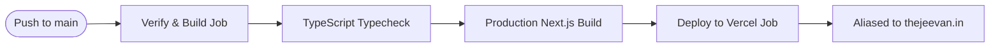

# Deployment & CI/CD Pipeline Blueprint — thejeevan.in

**Domain:** `thejeevan.in` / `www.thejeevan.in`  
**Host & Infrastructure:** Vercel (Production Edge Network)  
**Personal Account:** `jeevanpaul766` (`jeevanpaul766@gmail.com`)  
**GitHub Repository:** [`https://github.com/Jeevanpaul766/thejeevan-portfolio`](https://github.com/Jeevanpaul766/thejeevan-portfolio)  
**Framework:** Next.js 16 (App Router) + TypeScript + Tailwind CSS  
**CI/CD Pipeline:** GitHub Actions (`.github/workflows/ci-cd.yml`)

---

## 1. Production Project Identity (Personal Account)

- **Vercel Account:** `jeevanpaul766` (`jeevanpaul766@gmail.com`)
- **Vercel Project Name:** `thejeevan-portfolio`
- **Vercel Project ID:** `prj_Ze9YgzQLBj7Z6udyMfTbfz66Nrka`
- **Vercel Organization / Team ID:** `team_3K4q0EQIVt1mkTlV6FTcSifl`
- **Active Deployment URL:** [`https://thejeevan-portfolio-beige.vercel.app`](https://thejeevan-portfolio-beige.vercel.app)
- **Primary Custom Domain:** `https://thejeevan.in`
- **Subdomain:** `https://www.thejeevan.in`

---

## 2. GoDaddy DNS Configuration Table

In your GoDaddy DNS Management console for **thejeevan.in** (as shown in your screenshot):

| Action | Type | Name | Data / Value | TTL | Notes |
|---|---|---|---|---|---|
| **Edit Existing** | `A` | `@` | `216.198.79.1` (or `76.76.21.21`) | 600s / 1/2 Hour | Replace current `Parked` |
| **Add New** | `TXT` | `_vercel` | `vc-domain-verify=thejeevan.in,19c18f69ff6835ce7d1f` | 1/2 Hour | Ownership verification record |
| **Edit Existing** | `CNAME` | `www` | `cname.vercel-dns.com.` | 1 Hour | Route `www.thejeevan.in` to Vercel |
| *Keep as is* | `NS` | `@` | `ns19.domaincontrol.com.` / `ns20` | 1 Hour | Default GoDaddy nameservers |
| *Keep as is* | `TXT` | `_dmarc` | *Existing DMARC record* | 1 Hour | Email security record |

---

## 3. Domain Association in Vercel

If you previously tested adding `thejeevan.in` under another Vercel team (e.g. `trivexatechnologiesdev`), ensure it is removed there:
1. Go to your personal project domains settings: [vercel.com/jeevanpaul766s-projects/thejeevan-portfolio/settings/domains](https://vercel.com/jeevanpaul766s-projects/thejeevan-portfolio/settings/domains)
2. Add `thejeevan.in` and `www.thejeevan.in`
3. Vercel will verify the A and CNAME records and issue a free automatic SSL certificate.

---

## 4. GitHub Actions CI/CD Pipeline

The automated CI/CD pipeline is in [`.github/workflows/ci-cd.yml`](.github/workflows/ci-cd.yml).

### Pipeline Execution Flow


### GitHub Secrets Configuration
In your GitHub repo (`https://github.com/Jeevanpaul766/thejeevan-portfolio`), navigate to **Settings ➔ Secrets and variables ➔ Actions** and add:
- **`VERCEL_TOKEN`**: Created from [vercel.com/account/tokens](https://vercel.com/account/tokens) under your `jeevanpaul766` account.
- **`VERCEL_ORG_ID`**: `team_3K4q0EQIVt1mkTlV6FTcSifl`
- **`VERCEL_PROJECT_ID`**: `prj_Ze9YgzQLBj7Z6udyMfTbfz66Nrka`

---

## 5. Local Commands

```bash
# Deploy to preview
npm run deploy:preview

# Deploy directly to production under jeevanpaul766
npm run deploy
```
